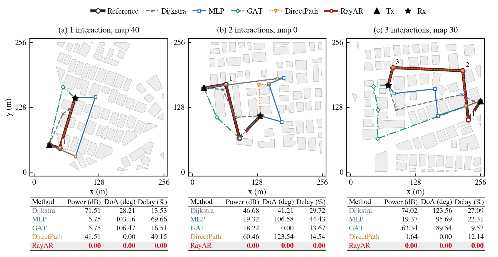

# RayAR

Implementation of **RayAR: Neural Autoregressive for Fast Dominant Radio Propagation Path Estimation**.

RayAR reconstructs dominant diffraction paths between a specified transmitter and receiver through geometry-constrained autoregressive vertex selection.



## Installation

Requires Python 3.10+ and PyTorch 2.1+.

```bash
python -m pip install -e .
```

## Data

Use the propagation data released with [D²LoS](https://arxiv.org/abs/2603.27976). Place the prepared assets under:

```text
assets/buildings/    Building geometry
assets/cache/        Propagation cache
assets/los/          Visibility and geometry arrays
models/last.pt       Trained checkpoint
```

Data paths are configurable in `configs/`. Data and checkpoints are provided separately.

## Usage

```bash
# Train
python main.py --config configs/full_100map_reference.json train \
  --output output/full --gpu 0

# Evaluate
python main.py --config configs/maps20.json eval \
  --checkpoint models/last.pt --output output/eval.json --gpu 0

# Infer
python infer.py --input examples/query.json \
  --checkpoint models/last.pt --output output/query.json --gpu 0
```

`examples/query.json` specifies the map, one Tx position, and a list of Rx positions. The `src/los/` directory contains the optional C++ preprocessing backend.

Code is organized directly under `src/model`, `src/data`, `src/geom`, `src/train`, `src/eval`, `src/runtime`, and `src/cli`.
